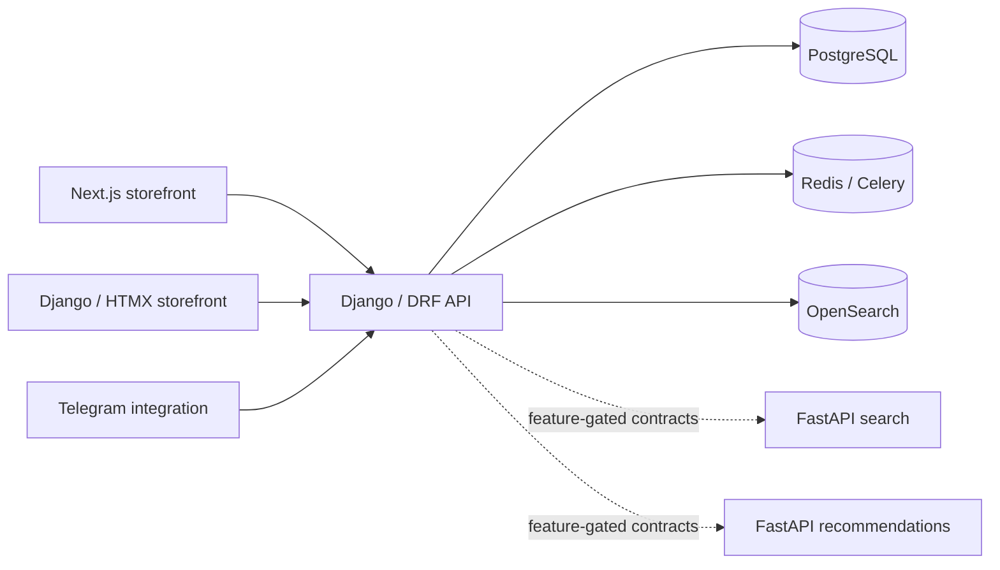

# Servio

**A multi-vendor B2B marketplace engineering project** with corporate purchasing workflows, catalog search, recommendation experiments, and a migration from a Django-rendered storefront to Next.js.

[Architecture](docs/ARCHITECTURE.md) · [Technical case study](docs/PORTFOLIO.md) · [Local setup](docs/LOCAL_DEVELOPMENT.md) · [Current priorities](TODO.md) · [API reference](backend/API.md)

> **Project status:** an actively developed prototype/reference implementation, **not a verified production-ready SaaS**. The repository contains working modules alongside legacy storefront code, migration adapters and experimental services. No live demo, traffic figures or performance claims are implied.

## What this project demonstrates

| Area | Evidence in the repository |
| --- | --- |
| **Marketplace domain** | Product catalog, taxonomy, seller offers, inventory, company workspaces, multi-seller orders and approvals in `backend/` |
| **Backend & APIs** | Django + Django REST Framework, OpenAPI/Swagger, service-layer orchestration and PostgreSQL |
| **Storefront migration** | Server-rendered Django/HTMX storefront plus a Next.js/React storefront foundation in `frontend/` |
| **Discovery** | OpenSearch integration; FastAPI search and recommendation *contract/bridge* services with Django fallback |
| **Async & integrations** | Redis, Celery jobs, Telegram bot integrations and order-feedback processing |
| **Platform engineering** | Docker Compose, Swarm deployment manifests, GitHub Actions, Prometheus/Grafana/Loki observability and security checks |

The current Python dependency declaration is in [`backend/pyproject.toml`](backend/pyproject.toml); frontend versions are in [`frontend/package.json`](frontend/package.json). Prefer those manifests over screenshots or outdated descriptions.

## Architecture at a glance



Search and recommendation service extraction is **incremental**; the diagram does not assert that both standalone services carry all production traffic. See [architecture boundaries](docs/ARCHITECTURE.md) and [API migration plan](docs/API_PLATFORM_PLAN_FASTAPI_SEARCH_RECO_RU.md).

## Explore the code

- `backend/catalog/` — products, brands, categories, reviews, offers and catalog API
- `backend/commerce/` — legal entities, memberships and corporate workspaces
- `backend/orders/` — order lifecycle, checkout attribution and background tasks
- `backend/shopfront/` — legacy storefront, search/recommendation orchestration
- `backend/storefront_api/` — API adapters for the Next.js buyer experience
- `frontend/` — Next.js storefront and buyer flows
- `services/search-api/`, `services/recommendation-api/` — FastAPI service boundaries
- `deploy/` — infrastructure, telemetry and Swarm configuration
- `AGENTS.md` — repository-local development-agent conventions

## Run locally

Prerequisites: Docker with the Compose plugin. Commands run from the repository root.

```bash
cp backend/.env.example backend/.env
cp bot/.env.example bot/.env
cp bot/.env.notify.example bot/.env.notify
docker compose -f docker-compose.yml -f docker-compose.dev.yml up --build
# In another terminal:
make migrate
make test
```

Common local endpoints (when the relevant services are running):

- Storefront: http://localhost:8080/
- Django admin: http://localhost:8080/admin/
- OpenAPI / Swagger: http://localhost:8080/api/docs/
- ReDoc: http://localhost:8080/api/redoc/

For development commands, optional observability services, reindexing and prerequisites, use [local development instructions](docs/LOCAL_DEVELOPMENT.md). Never commit real `.env` files.

## Quality and known limitations

The repository defines backend tests/coverage, frontend build/typechecks, CI, dependency audit and deployment checks. **A defined pipeline is not proof of a passing pipeline**: check the [latest GitHub Actions runs](https://github.com/two-potato/servio/actions) before treating any release as validated.

Current work focuses on getting CI green, proving recommendation event/feedback continuity end to end, and completing the Next.js buyer-flow migration. The deliberately short, evidence-based backlog is in [TODO.md](TODO.md).

## About this repository

This is a technical portfolio case study, not a ready-made online store. The codebase includes earlier iterations and operational references from related experiments, including a separate 24sparts deployment concept. Those references **do not make 24sparts a feature or live demo of Servio**. See [technical case study](docs/PORTFOLIO.md) for what is implemented, what is transitional, and what still needs validation.
