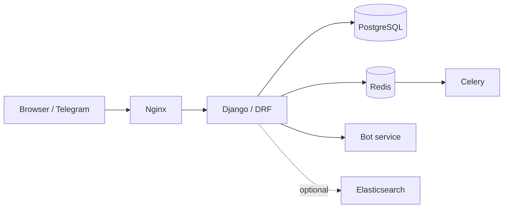

# Servio

**E-commerce backend and infrastructure portfolio project.**

Servio explores a commerce workflow from catalog and authentication to order processing, notifications and observability. This repository contains the Django 5.2 implementation on the current development branch, not a claim of a finished commercial marketplace.

## Architecture

| Layer | Implementation |
| --- | --- |
| Application | Python 3.12+, Django 5.2, Django REST Framework |
| Web interface | Django templates, HTMX, Bootstrap; Tailwind build helper |
| Background jobs | Celery worker and beat, Redis |
| Storage | PostgreSQL 16 |
| Integration | Telegram bot / WebApp, Google OAuth configuration, PDF invoices |
| Search | Elasticsearch 8.14 (disabled by the development override) |
| Infrastructure | Docker Compose, Nginx, Gunicorn/Uvicorn |
| Observability | Optional Prometheus, Grafana, Loki and exporters |



## Review this project

- [Backend dependencies](backend/pyproject.toml)
- [Service topology](docker-compose.yml)
- [Development overrides](docker-compose.dev.yml)
- [CI workflow](.github/workflows/ci.yml)
- [Make targets](Makefile)

CI is configured for backend tests, coverage, deployment-settings checks and lint. See [Actions](https://github.com/two-potato/servio/actions) for actual results; configured checks are not proof of a passing run.

## Local development

Use a clean disposable development host with Docker Engine and Compose v2. The stack uses fixed external volume names and container names: do not run these steps against a production Docker context or reuse production data.

```bash
git clone https://github.com/two-potato/servio.git
cd servio
git switch dev
cp backend/.env.example backend/.env
cp bot/.env.example bot/.env
# Review both files, set local-only secrets and integration settings.
for volume in pgdata esdata redisdata staticfiles; do
  docker volume create "servio_${volume}"
done
docker compose -f docker-compose.yml -f docker-compose.dev.yml config --quiet
docker compose -f docker-compose.yml -f docker-compose.dev.yml up --build
```

The base compose publishes Nginx on port 8080 by default (override with NGINX_HTTP_PORT). The backend startup command runs migrations. In a second terminal:

```bash
docker compose -f docker-compose.yml -f docker-compose.dev.yml ps
docker compose -f docker-compose.yml -f docker-compose.dev.yml exec backend /app/.venv/bin/python manage.py createsuperuser
docker compose -f docker-compose.yml -f docker-compose.dev.yml exec backend /app/.venv/bin/python -m pytest
```

Expected local routes, subject to configuration: http://localhost:8080/, /admin/, /api/docs/ and /health/. Optional integrations may require your own test credentials. Never commit .env files or actual customer data.

Stop the development services without deleting volumes:

```bash
docker compose -f docker-compose.yml -f docker-compose.dev.yml down
```

## Frontend asset development

To rebuild the optional Tailwind assets, install the locked Node dependencies locally:

```bash
npm ci
npm run tw:build
```

Commit source assets and package-lock.json, not node_modules.

## Branch and deployment policy

Development lives in dev; main is intended for production. Changes should go through CI and review before merging into main. The production deployment workflow must be reviewed before triggering it. Do not use production secrets for local testing.

## Current limitations

- Fresh-clone startup and CI status must be checked on the exact revision being reviewed.
- No public load-test, production SLA or measured commercial performance is claimed.
- Telegram and OAuth depend on external configuration.
- The project is an individual, AI-assisted engineering portfolio; architecture, configuration and test evidence should be reviewed independently.
